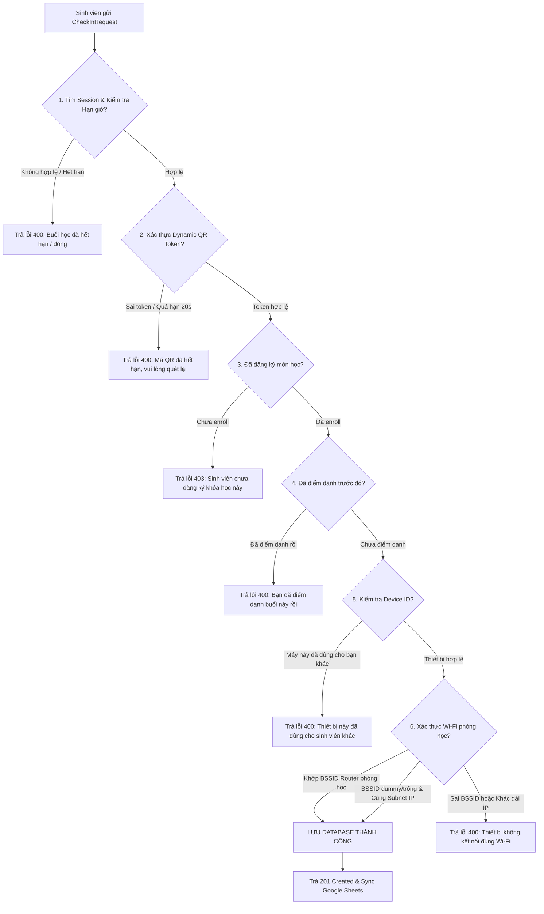

# 📱 Hướng Dẫn Tích Hợp Frontend: Chức Năng Quét QR Điểm Danh & Xác Thực Wi-Fi

> **Tài liệu kỹ thuật chính thức dành cho lập trình viên Frontend (Web / Flutter Desktop / Mobile App PRM323)**  
> Mô tả chi tiết cách thức **Backend tiếp nhận, giải mã, kiểm tra an ninh đa tầng** khi sinh viên quét mã QR điểm danh, hướng dẫn cấu hình môi trường test thực tế giữa Laptop & Điện thoại, và các **điều chỉnh cần thiết trong Source Code phía Frontend**.

---

## 📑 Mục Lục
1. [Tổng quan cơ chế điểm danh mới (Dynamic QR + Wi-Fi Thích Ứng Đa Tầng)](#1-tổng-quan-cơ-chế-điểm-danh-mới)
2. [Chi tiết luồng Backend xử lý khi Sinh viên Scan QR](#2-chi-tiết-luồng-backend-xử-lý-khi-sinh-viên-scan-qr)
3. [Hướng dẫn Cấu hình Môi trường Test Thực tế (Laptop & Điện thoại)](#3-hướng-dẫn-cấu-hình-môi-trường-test-thực-tế-laptop--điện-thoại)
4. [Những điều chỉnh cần làm phía Frontend](#4-những-điều-chỉnh-cần-làm-phía-frontend)
   - [4.1. Màn hình Giảng viên (Web / Flutter Desktop / Máy chiếu)](#41-màn-hình-giảng-viên-web--flutter-desktop--máy-chiếu)
   - [4.2. Màn hình Sinh viên (Flutter Mobile App Quét QR)](#42-màn-hình-sinh-viên-flutter-mobile-app-quét-qr)
5. [Định dạng API Contract (Request & Response)](#5-định-dạng-api-contract-request--response)
6. [Bảng mã lỗi và Kịch bản hiển thị giao diện (UI Handling)](#6-bảng-mã-lỗi-và-kịch-bản-hiển-thị-giao-diện-ui-handling)
7. [Checklist kiểm tra cho đội Frontend](#7-checklist-kiểm-tra-cho-đội-frontend)

---

## 1. Tổng quan cơ chế điểm danh mới

Hệ thống điểm danh đã được nâng cấp lên **Mô hình Xác thực 3 Lớp Thích Ứng**:

```
      [ MÁY TÍNH GIẢNG VIÊN (Desktop/Web) ]                  [ APP MOBILE SINH VIÊN ]
                       │                                                  │
          • Hiển thị QR động (đổi mỗi 20s qua TOTP)          • Camera quét chuỗi 8 ký tự Hex
          • Thanh countdown đếm ngược 20s (tùy chỉnh)        • Đọc BSSID (MAC router Wi-Fi)
          • Tự động bắt IP Wi-Fi / Public IP                 • Lấy Device ID phần cứng máy
                       │                                                  │
                       └─────────────────────────┬────────────────────────┘
                                                 │ Gửi POST /api/attendance/check-in
                                                 ▼
                                      [ SPRING BOOT BACKEND ]
                           ┌──────────────────────────────────────────┐
                           │ 1. Xác thực Token TOTP (Chu kỳ 20s/tùy chọn)
                           │ 2. Khóa thiết bị (1 máy = 1 sinh viên)   │
                           │ 3. Wi-Fi: Trùng BSSID HOẶC Cùng Subnet   │
                           │    (Hỗ trợ IPv4 /24, IPv6 /64, LAN Dev)  │
                           │ 4. Kiểm tra Enrollment & Chống quét lặp  │
                           └──────────────────────────────────────────┘
```

---

## 2. Chi tiết luồng Backend xử lý khi Sinh viên Scan QR

Khi sinh viên dùng Camera quét mã trên máy chiếu/laptop và App gửi request `POST /api/attendance/check-in`, Backend thực hiện tuần tự **6 bước kiểm tra nghiêm ngặt**:



### Chi tiết các bước xử lý nội bộ của Backend:
1. **Giải mã Token (`qrToken`) bằng thuật toán TOTP**:
   - Backend lấy mã `qrCodeSecret` gốc của buổi học và thời gian hiện tại để tính toán lại mã token hợp lệ bằng thuật toán HMAC-SHA256.
   - Dung sai: Cho phép lệch $\pm 1$ chu kỳ ($\pm 10$ giây), tức sinh viên có tổng cộng **~20 giây** từ lúc mã xuất hiện đến khi bấm gửi request (bù trừ độ trễ mạng 4G/Wi-Fi và thời gian lấy nét của camera).
2. **Khóa Định Danh Thiết Bị (`deviceId`)**:
   - Backend kiểm tra trong bảng `attendance_records` xem `deviceId` này đã có mặt trong buổi học (`sessionId`) chưa.
   - Nếu đã có sinh viên khác dùng thiết bị này để điểm danh $\rightarrow$ **Từ chối ngay lập tức**. Mục đích: Chống trường hợp 1 bạn đi học cầm nhiều điện thoại hoặc đăng xuất để điểm danh hộ bạn ở nhà.
3. **Đối chiếu Mạng Wi-Fi Thích Ứng Đa Tầng (Adaptive Wi-Fi)**:
   - **Tầng 1 (BSSID Router)**: Nếu session có cấu hình `roomBssid` hợp lệ và điện thoại gửi lên `bssid` hợp lệ trùng khớp $\rightarrow$ Xác thực thành công 100%.
   - **Tầng 2 (Lọc BSSID Ảo & Fallback)**: Trên Android, nếu người dùng tắt GPS, hệ điều hành sẽ trả về MAC giả `02:00:00:00:00:00` hoặc chuỗi `unknown`. Backend **tự động phát hiện và bỏ qua giá trị ảo này**, sau đó chuyển tiếp xuống kiểm tra dải IP mạng để không chặn nhầm sinh viên.
   - **Tầng 3 (IP Subnet /24 & IPv6 /64)**: So sánh IP thực của sinh viên với IP của giảng viên (`hostPublicIp`). Cho phép dung sai cùng dải mạng `/24` (3 octet đầu giống nhau, VD: `192.168.1.*` hoặc `118.69.12.*`), giải quyết triệt để vấn đề Router trường học cân bằng tải Multi-WAN và mạng Wi-Fi gia đình cấp IP qua DHCP.
   - **Tầng 4 (Hỗ trợ Local Dev / Pair-Testing)**: Nếu phiên điểm danh tạo trên máy tính qua `localhost` (`127.0.0.1`), Backend tự động liên kết với card mạng Wi-Fi vật lý của Laptop (`192.168.1.x`) để cho phép điện thoại trên cùng Wi-Fi điểm danh thành công.

---

## 3. Hướng dẫn Cấu hình Môi trường Test Thực tế (Laptop & Điện thoại)

Khi chạy test chức năng giữa **Laptop (Giảng viên chiếu QR)** và **Điện thoại di động (Sinh viên quét QR)**:

### ⚠️ Lưu ý sống còn về URL kết nối từ Điện thoại
1. **Cả Laptop và Điện thoại phải kết nối cùng 1 mạng Wi-Fi** (ví dụ Wi-Fi tên `"kienhoa"`).
2. **Trên Điện thoại, KHÔNG ĐƯỢC trỏ API về `localhost`**:
   - `localhost` trên điện thoại chính là bản thân chiếc điện thoại, không phải chiếc laptop!
   - Hãy kiểm tra địa chỉ IPv4 card Wi-Fi của Laptop bằng lệnh `ipconfig` (ví dụ: `192.168.1.116`).
   - Cấu hình API Base URL trong code Mobile App trỏ tới IP của Laptop:
     ```dart
     // ❌ SAI trên Điện thoại:
     const String baseUrl = "http://localhost:8080/api";
     
     // ✅ ĐÚNG trên Điện thoại khi test qua Wi-Fi chung:
     const String baseUrl = "http://192.168.1.116:8080/api";
     ```
3. **Mở Firewall Port 8080 trên Laptop (nếu điện thoại không kết nối được)**:
   - Trên Windows, mở PowerShell với quyền Administrator và chạy lệnh cho phép kết nối vào cổng 8080:
     ```powershell
     New-NetFirewallRule -DisplayName "PRM323 Attendance Backend" -Direction Inbound -LocalPort 8080 -Protocol TCP -Action Allow
     ```

---

## 4. Những điều chỉnh cần làm phía Frontend

### 4.1. Màn hình Giảng viên (Web / Flutter Desktop / Máy chiếu)

#### Thay đổi 1: Khi tạo buổi điểm danh (`POST /api/sessions`)
- **Tùy chỉnh thời gian làm mới mã QR (`qrRefreshSeconds`)**:
  - Giảng viên có thể **tự điều chỉnh thời gian đổi mã QR** ngay trên màn hình tạo buổi học (ví dụ: Dropdown chọn `10 giây`, `20 giây`, `30 giây`, `60 giây` hoặc Slider/ô nhập số từ 5 đến 300 giây).
  - **Mặc định là 20 giây** nếu Giảng viên không chỉnh sửa hoặc để trống trường này.
  - Gửi request `POST /api/sessions`:
    ```json
    {
      "courseId": "CRS-001",
      "slotNumber": 1,
      "expiredAt": "2026-09-25T12:00:00",
      "qrRefreshSeconds": 20
    }
    ```
- **Không cần nhập IP**: Giảng viên không cần nhập `roomNetworkIp`. Backend sẽ tự động lấy IP Wi-Fi của máy giảng viên.
- **Không cần nhập BSSID trên Web/Desktop**: Trên trình duyệt Web và Flutter Desktop, hệ điều hành không hỗ trợ lấy BSSID Wi-Fi (trả về `null`). Giảng viên **để trống trường `roomBssid`**, hệ thống sẽ tự động dùng cơ chế so khớp IP mạng.

#### Thay đổi 2: Hiển thị mã QR động và thanh đếm ngược Countdown (Mặc định 20s)
Frontend lựa chọn 1 trong 2 cách sau:

##### 👉 Cách 1: Dùng Server-Sent Events (SSE) — Khuyến nghị (Mượt mà nhất)
Mở kết nối SSE tới `GET /api/sessions/{sessionId}/qr-stream`:
```dart
// Ví dụ với Flutter / Dart:
import 'dart:convert';
import 'package:http/http.dart' as http;

void listenToQrStream(String sessionId, String jwtToken) {
  final client = http.Client();
  final request = http.Request('GET', Uri.parse('$baseUrl/sessions/$sessionId/qr-stream'));
  request.headers['Authorization'] = 'Bearer $jwtToken';
  request.headers['Accept'] = 'text/event-stream';

  client.send(request).then((response) {
    response.stream.transform(utf8.decoder).transform(const LineSplitter()).listen((line) {
      if (line.startsWith('data:')) {
        final jsonStr = line.substring(5).trim();
        final data = jsonDecode(jsonStr);

        // 1. Cập nhật ảnh QR Base64 lên giao diện
        final qrBase64 = data['qrCodeBase64']; 
        
        // 2. Cập nhật chuỗi text 8 ký tự
        final token = data['currentQrToken']; 
        
        // 3. Chu kỳ làm mới (mặc định 20s hoặc theo cấu hình giảng viên)
        final totalInterval = data['tokenIntervalSeconds'] ?? 20;
        
        // 4. Cập nhật thanh đếm ngược (đếm từ totalInterval về 0s)
        final remainingSeconds = data['tokenRemainingSeconds'];
        updateProgressBar(remainingSeconds, totalInterval);
      }
    });
  });
}
```

##### 👉 Cách 2: Polling định kỳ mỗi 5–8 giây
Gọi API: `GET /api/sessions/{sessionId}/current-token`
- Cập nhật ảnh `qrCodeBase64` và vẽ thanh countdown từ `tokenRemainingSeconds`.

---

### 4.2. Màn hình Sinh viên (Flutter Mobile App Quét QR)

Khi sinh viên bấm nút "Quét QR Điểm Danh" trên App:

#### Bước 1: Quét mã QR bằng Camera
- Trình quét QR sẽ đọc được nội dung mã QR trên máy chiếu.
- Nội dung quét được chính là chuỗi `qrToken` (Ví dụ: `4F3A8B12`).

#### Bước 2: Lấy thông tin BSSID của Wi-Fi (Lưu ý về quyền GPS)
Sử dụng package `network_info_plus` và `permission_handler`:
```dart
import 'package:network_info_plus/network_info_plus.dart';
import 'package:permission_handler/permission_handler.dart';

Future<String?> getDeviceBssid() async {
  try {
    // Trên Android 8+, việc đọc BSSID Wi-Fi yêu cầu quyền Vị trí (Location)
    var status = await Permission.locationWhenInUse.status;
    if (!status.isGranted) {
      status = await Permission.locationWhenInUse.request();
    }
    
    final info = NetworkInfo();
    String? bssid = await info.getWifiBSSID();
    
    // Nếu hệ điều hành trả về MAC dummy do tắt GPS, chuyển thành null để Backend tự động fallback sang kiểm tra IP
    if (bssid == "02:00:00:00:00:00" || bssid == "unknown") {
      return null;
    }
    return bssid;
  } catch (e) {
    // Không để lỗi BSSID làm crash ứng dụng, trả về null để Backend kiểm tra bằng IP
    return null;
  }
}
```

#### Bước 3: Lấy định danh thiết bị (`deviceId`)
Sinh một mã UUID duy nhất khi cài app và lưu vào `SharedPreferences` (Android) hoặc `FlutterSecureStorage` (iOS) để mã không đổi giữa các lần mở app:
```dart
import 'package:shared_preferences/shared_preferences.dart';
import 'package:uuid/uuid.dart';

Future<String> getOrCreateDeviceId() async {
  final prefs = await SharedPreferences.getInstance();
  String? deviceId = prefs.getString('attendance_device_id');
  if (deviceId == null || deviceId.isEmpty) {
    deviceId = const Uuid().v4();
    await prefs.setString('attendance_device_id', deviceId);
  }
  return deviceId;
}
```

#### Bước 4: Gửi Request điểm danh lên Backend
Gửi request `POST /api/attendance/check-in`:
```dart
Future<void> submitAttendance({
  required String sessionId,
  required String qrToken,
}) async {
  final bssid = await getDeviceBssid();
  final deviceId = await getOrCreateDeviceId();

  final response = await http.post(
    Uri.parse('$baseUrl/attendance/check-in'),
    headers: {
      'Content-Type': 'application/json',
      'Authorization': 'Bearer $studentJwtToken',
    },
    body: jsonEncode({
      'sessionId': sessionId,
      'qrToken': qrToken,
      if (bssid != null) 'bssid': bssid,
      'deviceId': deviceId,
    }),
  );

  final result = jsonDecode(utf8.decode(response.bodyBytes));
  if (response.statusCode == 201) {
    showSuccessDialog("Điểm danh thành công!");
  } else {
    showErrorDialog(result['message'] ?? "Điểm danh thất bại");
  }
}
```

---

## 5. Định dạng API Contract (Request & Response)

### API 0: Giảng viên Tạo buổi điểm danh
- **URL**: `POST /api/sessions`
- **Header**: `Authorization: Bearer <JWT_LECTURER_TOKEN>`
- **Content-Type**: `application/json`

#### Request Body:
| Field | Type | Bắt buộc | Mặc định | Mô tả |
| :--- | :--- | :---: | :---: | :--- |
| `courseId` | String | ✅ | - | ID khóa học (VD: `CRS-SWP391`). |
| `slotNumber` | Integer | ✅ | - | Tiết học trong ngày (1 đến 6). |
| `expiredAt` | String (ISO) | ✅ | - | Thời gian kết thúc điểm danh (`yyyy-MM-ddTHH:mm:ss`). |
| `qrRefreshSeconds` | Integer | ❌ | **20** | **Thời gian tự động đổi mã QR (giây)**. Tối thiểu: 5, Tối đa: 300. |
| `roomNetworkIp` | String | ❌ | Tự động | IP mạng phòng học (để trống: Backend tự bắt IP Wi-Fi giảng viên). |
| `roomBssid` | String | ❌ | Để trống | BSSID MAC router phòng học (để trống khi tạo trên Web/Desktop). |

#### Request Body mẫu:
```json
{
  "courseId": "CRS-001",
  "slotNumber": 1,
  "expiredAt": "2026-09-25T12:00:00",
  "qrRefreshSeconds": 20
}
```

---

### API 1: Sinh viên Điểm danh
- **URL**: `POST /api/attendance/check-in`
- **Header**: `Authorization: Bearer <JWT_STUDENT_TOKEN>`
- **Content-Type**: `application/json`

#### Request Body:
| Field | Type | Bắt buộc | Mô tả |
| :--- | :--- | :---: | :--- |
| `sessionId` | String | ⚠️ | ID buổi học (lấy từ mã QR hoặc màn hình chọn buổi học). |
| `qrToken` | String | ⚠️ | **Chuỗi token quét được từ camera** (8 ký tự Hex, VD: `4F3A8B12`). |
| `sessionCode` | String | ⚠️ | Mã PIN 6 số (dùng nhập thủ công khi camera hỏng). |
| `bssid` | String | ❌ | Địa chỉ MAC router Wi-Fi phòng học (VD: `c8:0e:14:2b:8a:90`). Tự động bỏ qua nếu là mã dummy `02:00:00:00:00:00`. |
| `deviceId` | String | ❌ | Mã định danh thiết bị vật lý (Chống điểm danh hộ nhiều máy). |

*(Lưu ý: Phải có ít nhất `qrToken` hoặc `sessionCode`)*.

#### Response Thành công (`201 Created`):
```json
{
  "success": true,
  "message": "Điểm danh thành công",
  "data": {
    "recordId": "REC-9D2F1B0A",
    "sessionId": "SES-8B7C2A1E",
    "studentId": "USR-A1B2C3D4",
    "studentFapCode": "SE192964",
    "studentName": "Ngô Hoàng Trường Đạt",
    "status": "PRESENT",
    "deviceId": "DEV-ANDROID-987654",
    "checkedAt": "2026-09-25T09:45:00"
  },
  "timestamp": "2026-09-25T02:45:00.000Z"
}
```

---

### API 2: Lấy mã QR Token hiện tại (Polling cho Giảng viên)
- **URL**: `GET /api/sessions/{sessionId}/current-token`
- **Header**: `Authorization: Bearer <TOKEN>`

#### Response (`200 OK`):
```json
{
  "success": true,
  "message": "Lấy mã QR token thành công",
  "data": {
    "sessionId": "SES-8B7C2A1E",
    "currentQrToken": "4F3A8B12",
    "tokenRemainingSeconds": 17,
    "tokenIntervalSeconds": 20,
    "qrRefreshSeconds": 20,
    "qrCodeBase64": "iVBORw0KGgoAAAANSUhEUgAAAPoAAAD6...",
    "status": "ACTIVE"
  },
  "timestamp": "2026-09-25T02:45:00.000Z"
}
```

---

### API 3: Stream QR Realtime qua SSE (Server-Sent Events)
- **URL**: `GET /api/sessions/{sessionId}/qr-stream`
- **Header**: `Accept: text/event-stream`
- **Event Name**: `qr-token`
- **Tần suất**: Tự động push dữ liệu mỗi 1 giây kèm số giây countdown còn lại (`tokenRemainingSeconds` từ 20 về 0s).

---

## 6. Bảng mã lỗi và Kịch bản hiển thị giao diện (UI Handling)

Frontend cần bắt các mã lỗi nghiệp vụ sau từ Backend để hiển thị thông báo thân thiện cho sinh viên:

| HTTP Status | Chi tiết `message` từ Backend | Nguyên nhân thực tế | Frontend nên hiển thị trên UI |
| :---: | :--- | :--- | :--- |
| **`400`** | *"Mã QR không hợp lệ hoặc đã hết hạn (mã QR tự làm mới mỗi 20 giây)..."* | Sinh viên quét mã cũ, mã trên máy chiếu vừa nhảy sang chu kỳ mới. | ⚠️ **"Mã QR đã chuyển sang chu kỳ mới. Vui lòng hướng camera quét lại mã trên màn hình!"** |
| **`400`** | *"Thiết bị không kết nối đúng mạng Wi-Fi phòng học (BSSID không khớp)"* | Sinh viên đang kết nối sang một mạng Wi-Fi khác ngoài phòng học. | 📡 **"Bạn chưa kết nối đúng Wi-Fi phòng học. Vui lòng kết nối vào Wi-Fi lớp học để điểm danh!"** |
| **`400`** | *"Thiết bị không kết nối cùng mạng Wi-Fi với giảng viên (Địa chỉ IP không khớp)"* | Khác dải IP mạng (dùng 4G, bật VPN/iCloud Private Relay, hoặc chưa vào Wi-Fi). | 🌐 **"Địa chỉ mạng không khớp. Vui lòng tắt 4G/VPN và kết nối cùng mạng Wi-Fi với giảng viên!"** |
| **`400`** | *"Thiết bị này đã được sử dụng để điểm danh cho một sinh viên khác..."* | 1 sinh viên đăng xuất ra rồi đăng nhập tài khoản bạn khác vào quét hộ trên cùng 1 điện thoại. | 🚫 **"Điểm danh thất bại! Thiết bị này đã được dùng để điểm danh cho sinh viên khác trong buổi học."** |
| **`400`** | *"Sinh viên đã thực hiện điểm danh cho buổi học này trước đó."* | Điểm danh trùng lặp. | ℹ️ **"Bạn đã hoàn thành điểm danh cho buổi học này rồi."** |
| **`403`** | *"Sinh viên chưa đăng ký tham gia khóa học này."* | Sinh viên quét nhầm mã của lớp khác. | ❌ **"Bạn không có tên trong danh sách đăng ký của khóa học này."** |
| **`400`** | *"Mã QR / Phiên điểm danh đã hết hạn."* | Buổi điểm danh đã bị đóng hoặc hết giờ quy định. | ⏰ **"Buổi điểm danh đã kết thúc."** |

---

## 7. Checklist kiểm tra cho đội Frontend

- [ ] **Màn hình Giảng viên**:
  - Thêm ô chọn / dropdown thời gian làm mới mã QR (`qrRefreshSeconds`, mặc định 20 giây: cho phép chọn 10s, 20s, 30s, 60s...) khi tạo buổi học.
  - Không cần nhập trường IP và BSSID khi tạo phiên điểm danh mới.
  - Tích hợp SSE hoặc Polling gọi `/api/sessions/{sessionId}/current-token`.
  - Hiển thị ảnh QR và vẽ thanh progress bar giảm dần từ `tokenIntervalSeconds` (mặc định 20) về 0 giây.
- [ ] **Màn hình Sinh viên**:
  - Khi test thực tế qua điện thoại: Trỏ API URL về địa chỉ IP Wi-Fi của Laptop (`http://<IP_LAN_MAY_TINH>:8080/api`).
  - Cập nhật camera scanner đọc chuỗi Text `qrToken` (8 ký tự).
  - Lấy mã định danh thiết bị `deviceId` (UUID) lưu trong bộ nhớ máy (SharedPreferences/SecureStorage).
  - Lấy địa chỉ `bssid` của Wi-Fi (có bọc try-catch, tự động bỏ qua nếu là mã giả `02:00:00:00:00:00`).
  - Xử lý các Dialog thông báo lỗi rõ ràng theo bảng mục 6.
